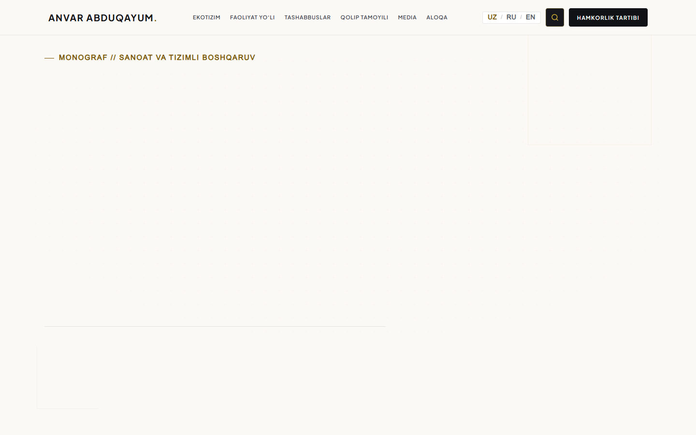

# Landing Sahifa Arxitekturasi va Matnlari (Landing Page Specification)

Ushbu spetsifikatsiya `replica/fixes.md` va `replica/brand.md` da belgilangan pozitsiyalash burchagi va brend ovoziga to'liq asoslangan.

---

## 1. Hero Bloki (The Hero)

- **Kicker:** `SANOAT VA EKSPORT EKOTIZIMI`
- **Asosiy Sarlavha (Headline):**  
  # 20 yillik sanoat tajribasi va barqaror ishlab chiqarish ekotizimi.
- **Qisqa Tavsif (Subheadline):**  
  Bo'sh motivatsion gaplar va noqulay taqvim byurokratiyasidan charchagan sanoat rahbarlari hamda B2B hamkorlar uchun tasdiqlangan zavod quvvatlari va to'g'ridan-to'g'ri ijrochi muloqoti.
- **Asosiy Harakat Tugmasi (Primary CTA):**  
  `[ Hamkorlik tartibi ]` (havola: `/[locale]/bron`)
- **Ikkilamchi Tugma (Secondary CTA):**  
  `[ Korxonalar dosyesi ]` (havola: `/[locale]#portfolio`)
- **Mahsulot Ekrani (Screenshot):**  
  

---

## 2. Bozor Muammosi (The Problem)

*Mavjud konsalting va taqvim xizmatlarining asosiy kamchiliklari:*

### Muammo 1: Taqvim havolalaridagi byurokratiya va 40% yo'qotish
Kompaniyalar uchrashuv belgilash uchun Calendly yoki boshqa chet el servislarining havolasini yuboradi. Natijada xaridor sana tanlashi, ko'p bosqichli formani to'ldirishi va elektron pochtasida tasdiq kutishi kerak bo'ladi. MDH va mahalliy sanoat bozorida esa rahbarlar email kutib o'tirmaydi — 40% dan ortiq potentsial yirik shartnomalar aynan shu bosqichda to'xtab qoladi.

### Muammo 2: Soxta motivatsiya va real ishlab chiqarish dalillarining yo'qligi
Internet "biznes-trenerlar" va quruq stock suratlarga to'la. Ular nazariya gapirishadi, lekin bitta ham ishlayotgan zavodga, dastgohlarga yoki eksport shartnomasiga ega emas. Haqiqiy B2B xaridor va investorga motivatsion shiorlar emas, ishlab chiqarish quvvati, dastgoh tonnaji va logistika yo'nalishlari kerak.

---

## 3. Qanday Ishlaydi? (How It Works)

3 ta oddiy va tezkor qadam:

1. **01 · Korxona Quvvati va Dosyeni Ko'ring:**  
   Toybola Toys, Samtech Masterbatches va boshqa sanoat aktivlarining real ishlab chiqarish tonnaji, texnik bazasi va eksport geografiyasini o'rganing.
2. **02 · Bir Bosishda Telegram Assistentga O'ting:**  
   Ortiqcha anketalarsiz, bevosita rasmiy Telegram orqali o'zingizga qulay format va vaqtni ma'lum qiling.
3. **03 · Strategik Kelishuv va Zavod Kooperatsiyasi:**  
   Yakkama-yakka strategik tahlil, korxona ekskursiyasi yoki OEM mahsulot ishlab chiqarish bo'yicha amaliy qadamlarni boshlang.

---

## 4. Asosiy Yechimlar va Imkoniyatlar (Key Features)

*Tadqiqotdagi shikoyatlar asosida qurilgan maxsus yechimlar:*

- **Direct Telegram Executive Handoff:** Taqvim byurokratiyasisiz to'g'ridan-to'g'ri Telegram orqali uchrashuvni kelishish.
- **Sertifikatlangan Korxonalar Dosyesi:** Har bir zavod bo'yicha yillik ishlab chiqarish quvvati, xomashyo va xodimlar soni.
- **Interaktiv OEM & Qolip Kalkulyatori:** Inyeksion qoliplash va polimer buyumlar ishlab chiqarish parametrlarini darhol hisoblash.
- **Xalqaro Eksport Koridorlari Xaritasi:** Qaysi mamlakatlarga qanday hajmda mahsulot yetkazib berilishi ko'rsatilgan logistika xaritasi.
- **Ko'rinmas Bot Qopqoni (Silent Honeypot):** Foydalanuvchini chalg'ituvchi Captcha-larsiz spam-botlarni 100% zararsizlantirish.
- **3 Tillik Xalqaro Sinxronizatsiya:** O'zbek, rus va ingliz tillarida to'liq texnik tenglik.

---

## 5. Hamkorlik va Xizmat Turlari (Pricing & Engagements)

| Hamkorlik yo'nalishi | Kim uchun | Format va Imkoniyatlar | Shartlar |
|---|---|---|:---:|
| **B2B Sanoat Kooperatsiyasi** | Xaridlar bo'yicha direktorlar, distribyutorlar, OEM buyurtmachilar | Qolip tayyorlash, polimer buyumlar quyish, xalqaro standartdagi yetkazib berish | To'g'ridan-to'g'ri shartnoma |
| **Yakkama-yakka Strategik Tahlil** | Yillik aylanmasi $500k+ bo'lgan korxona egalari va boshqaruvchilari | Zavod boshqaruvi, xarajatlar auditi, intizom va egasiz ishlaydigan tizim qurish | Oldindan kelishilgan tarif |
| **UZBIC Institutsional Loyihalari** | Investorlar, sanoat klasterlari va eksport uyushmalari | Sanoat ekotizimini kengaytirish, davlat-xususiy sektor kooperatsiyasi | Individual konsortsium |

---

## 6. Ko'p Beriladigan Savollar (FAQ)

**Savol: Uchrashuv belgilash uchun 10 ta savoldan iborat formani to'ldirishim shartmi?**  
*Javob:* Yo'q. Biz noqulay taqvim shakllaridan voz kechdik. Saytdagi tugmani bosish orqali to'g'ridan-to'g'ri Telegram assistentga yozishingiz va vaqtni darhol kelishishingiz mumkin.

**Savol: Xorijiy hamkorlar qaysi tillarda muloqot qila oladi?**  
*Javob:* Platforma va mas'ul vakillar o'zbek, rus va ingliz tillarida erkin faoliyat yuritadi. Hujjatlar va shartnomalar xalqaro standartlarda tayyorlanadi.

**Savol: Ishlab chiqarish korxonalariga shaxsan borib ko'rish mumkinmi?**  
*Javob:* Ha. Jiddiy B2B hamkorlar va strategik mijozlar uchun zavodlarga ekskursiya va dastgohlar faoliyatini joyida ko'rish tashkil etiladi.

**Savol: Yuborilgan so'rovlarga qancha vaqtda javob qaytariladi?**  
*Javob:* Barcha murojaatlar ish soatlarida 15-30 daqiqa ichida mas'ul mutaxassis tomonidan ko'rib chiqiladi.

---

## 7. Yakuniy Harakatga Da'vat (Final CTA)

### 20 yillik tajribaga tayangan holda korxonangizda mustahkam tizim quring.
Ortiqcha vositachilarsiz, amaliy sanoat kooperatsiyasi va to'g'ridan-to'g'ri muloqot.

`[ Hamkorlik arizasini yuborish ]`  
*(Bog'lanish Telegram orqali 1 daqiqa ichida amalga oshiriladi)*
